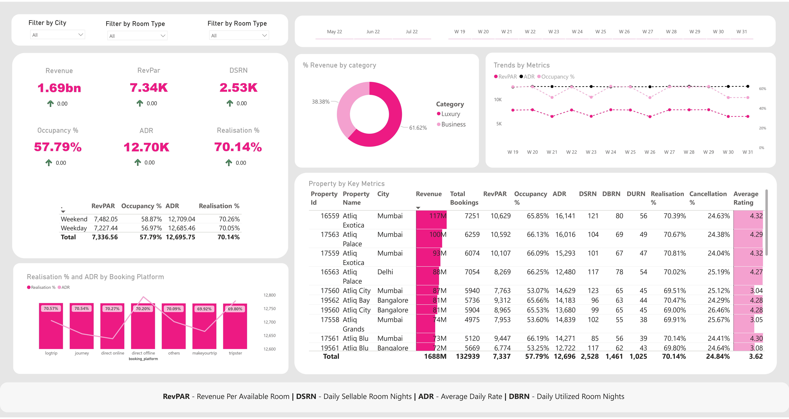

# OYO Rooms Booking Performance Dashboard: Hotel & Revenue Analytics

An interactive Power BI dashboard analyzing booking, revenue, and performance metrics across multiple OYO hotel properties -- built to help stakeholders monitor operational efficiency, compare properties, and optimize pricing and occupancy strategies.

## Business Problem

OYO needed a data-driven way to monitor hotel performance across cities and room categories, while reducing cancellations and maximizing revenue per available room.

## Data Source

Kaggle (OYO hotel booking dataset): detailed booking records for OYO properties, including booking platform, room class, occupancy, ratings, revenue, and weekly time-based performance, modeled against dimension tables for hotels, rooms, and dates.

## Tech Stack

- **Power BI Desktop** -- interactive reporting and dashboard creation
- **Power Query** -- cleaning and transforming data across multiple fact and dimension tables
- **DAX** -- KPIs, conditional logic, and time intelligence
- **SQL** -- data testing and validation
- **Excel** -- initial data exploration and preprocessing

## Key Visuals

- KPI cards: Total Revenue, RevPAR, DSRN, Occupancy %, ADR, Realisation %
- Property-wise table: Revenue, Bookings, RevPAR, Ratings, Cancellations, etc.
- Bar chart: Revenue by Week and Room Category
- Line chart: Weekly trends for RevPAR, ADR, Occupancy
- Clustered bar: Realisation % and ADR by Booking Platform
- Matrix table: Metrics split by Weekend vs. Weekday
- Pie chart: Revenue Share by Category (Luxury vs. Business)
- Slicers: City, Room Type, and Week Number

## Key Insights

- Total revenue across tracked weeks was ₹1.69B, across 132,939 total bookings
- Luxury rooms contributed over 60% of total revenue
- Atliq Exotica (Mumbai) was the top-performing property by both revenue and bookings
- Realisation % stayed consistent across platforms (~70%)
- Weekday vs. weekend performance showed similar ADR but varied occupancy, useful for pricing and promotion planning

## Files

- `Oyo Rooms Data Analysis Project.pbix` -- the Power BI report (open in Power BI Desktop)
- `dashboard-preview.jpg` -- static preview of the dashboard shown above
